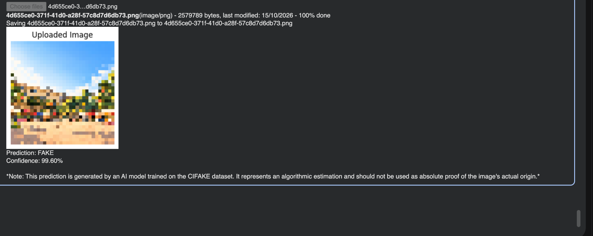
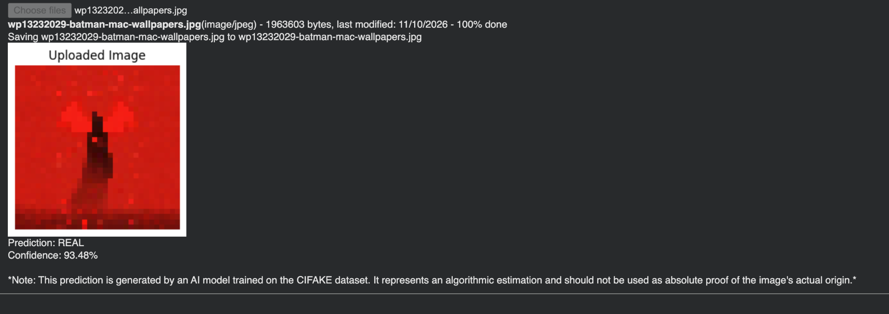

# Image Pixel Manipulator & AI Image Detector

A Python-based image processing project that combines pixel-level image manipulation with a Convolutional Neural Network (CNN) trained on the **CIFAKE** dataset to classify images as **FAKE** (AI-generated) or **REAL** (real-world image).

> **Disclaimer:** Predictions are model estimates, not proof of an image's origin. The model was trained on CIFAKE and may perform poorly on images from other sources or image types.

## Features

- Upload an image in Google Colab for prediction.
- Display the uploaded image alongside the prediction.
- Predict one of two classes: `FAKE` or `REAL`.
- Show a confidence-style score for the predicted class.
- Train and evaluate a CNN using the CIFAKE dataset.
- Experiment with image pixel manipulation and image processing.

## Example Predictions

### Predicted: FAKE

The model classified this uploaded landscape image as **FAKE**, with a displayed confidence score of **99.60%**.

### Predicted: REAL

The model classified this uploaded image as **REAL**, with a displayed confidence score of **93.48%**.

*These screenshots show example outputs from a run of the model. They do not establish the actual origin of either image.*

## Dataset

This project uses the **CIFAKE: Real and AI-Generated Synthetic Images** dataset from Kaggle:

- Dataset: [CIFAKE — Real and AI-Generated Synthetic Images](https://www.kaggle.com/datasets/birdy654/cifake-real-and-ai-generated-synthetic-images)
- Classes: `FAKE` and `REAL`
- The notebook loads the images into training and test datasets.

## Model Overview

The notebook uses a CNN built with TensorFlow/Keras. The model includes convolutional layers for learning image features, pooling and dropout layers, and a sigmoid output for binary classification.

Images are resized to **32 × 32** pixels to match the model's input shape. This makes experimentation lightweight, but resizing can remove details and affect predictions on high-resolution images.

## Run in Google Colab

1. Open the project notebook in Google Colab.
2. Install or import the required libraries (TensorFlow, NumPy, Matplotlib, and Pillow).
3. Download and extract the CIFAKE dataset, then confirm the training and test directory paths match the notebook.
4. Run the dataset-loading and model-training cells, or load your trained model if the notebook supports it.
5. Run the image-upload prediction cell.
6. Choose an image when prompted and review the displayed image, predicted class, and score.

## Interpreting the Score

The displayed confidence-style score is derived from the model's sigmoid output. It is **not necessarily a calibrated probability** that an image is truly real or AI-generated. A high score can still be wrong, especially for images unlike the CIFAKE training data.

## Limitations

- This is an experimental classifier, not a universal AI-image detector.
- Results can be affected by resizing, compression, edits, filters, and differences between datasets.
- The model predicts based on patterns learned during training; it does not verify metadata, provenance, or cryptographic authenticity.
- For fair evaluation, use validation data during model selection and keep the test set for final evaluation.

## Future Improvements

- Test robustness against blur, noise, brightness changes, resizing, and JPEG compression.
- Add a confusion matrix and precision/recall/F1 evaluation.
- Compare predictions before and after image manipulations.
- Explore Grad-CAM or other explainability methods to inspect image regions that influence predictions.
- Evaluate on external datasets to measure generalization.

## Tech Stack

- Python
- TensorFlow / Keras
- NumPy
- Matplotlib
- Pillow
- Google Colab
- CIFAKE dataset

## Disclaimer

This project is intended for learning and experimentation. Do not use its output as definitive evidence that an image is authentic or AI-generated.
